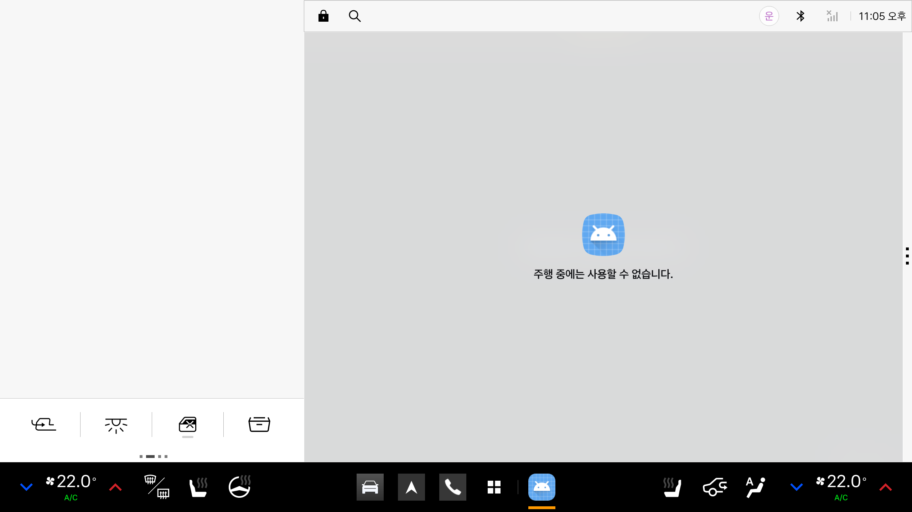
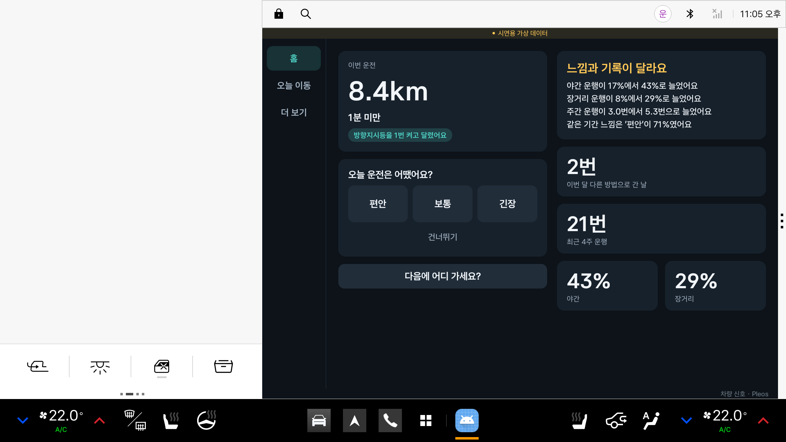
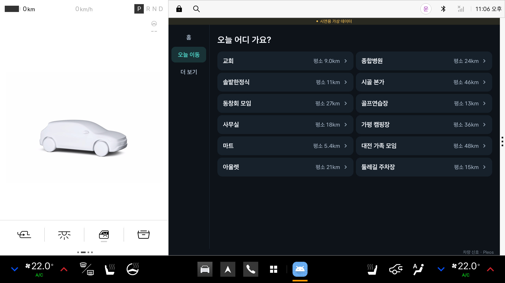
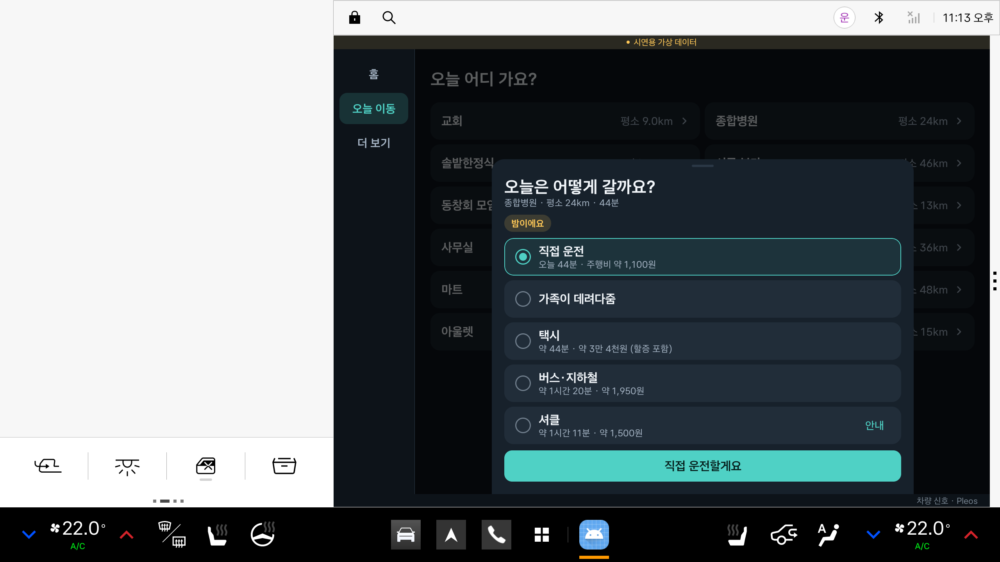
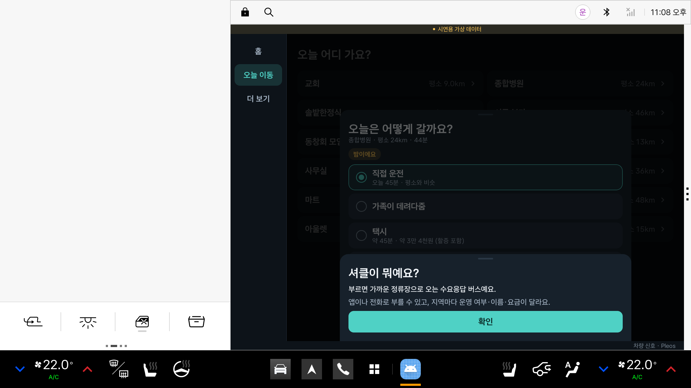
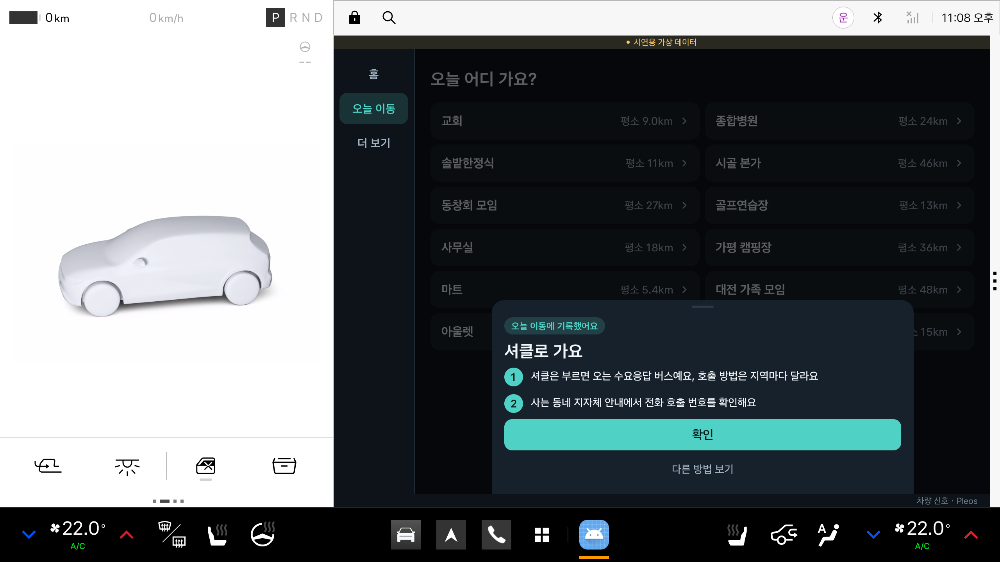
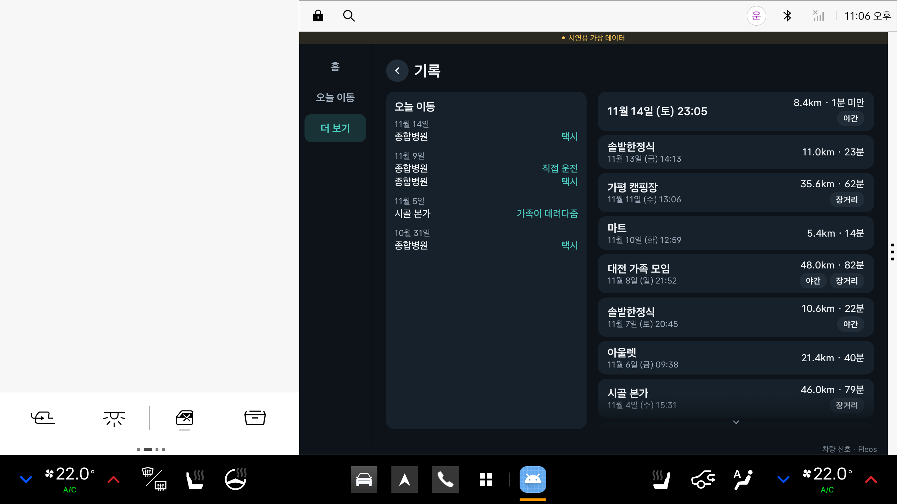
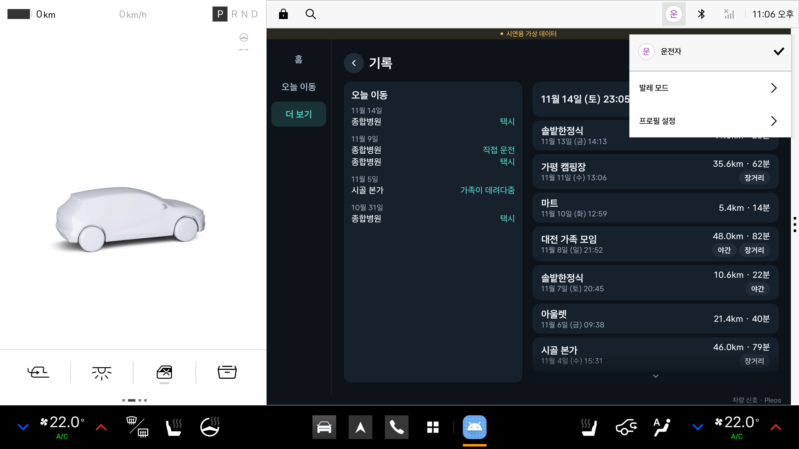

# 에브리웨이 (Everyway)

> 오래 편안하게 운전하도록 돕고, 주차한 차 안에서 다음 행선지를 직접 운전과 택시·버스·셔클로 갔을 때의 오늘 시간과 요금으로 견주어 보게 하는 Pleos Connect 차량 앱

현대자동차그룹 차량용 앱 개발 공모전 출품작(시제품). 주차(P)에서만 열리고, 기록은 현재 차량 프로필의 저장소에만 남으며, 점수·등급·판정 없이 사실만 보여 줍니다. 직접 운전이 기본이고 다른 방법은 같은 모양의 비교로만 보여 줍니다.

| 항목 | 내용 |
| --- | --- |
| 앱 이름 / applicationId | 에브리웨이 (Everyway) / `app.everyway.drive` (임시, 상표 확인 전) |
| 버전 | 0.1.0 (소스와 `apk/` 의 APK 는 같은 소스에서 빌드) |
| 환경 | Kotlin 2.0.21, Jetpack Compose, minSdk 28 / targetSdk 35, JDK 17, Gradle 8.11.1, AGP 8.7.2 |
| 확인한 에뮬레이터 | Pleos Connect Emulator v2.1.0 (Android 14, API 34, arm64), 화면 2560x1440 |
| 현재 단계 | 에뮬레이터에서 검증한 시제품 (실차 검증 없음) |
| APK | [`apk/team_app_release.apk`](apk/team_app_release.apk) (release, debug 키 서명. 제출 파일명은 `팀명_앱이름_release.apk` 규칙에 맞춰 변경) |
| 문서 기준일 | 2026-11-15 |

> **확인 범위 안내.** 화면의 이력은 모두 가상 데이터입니다(상단에 "시연용 가상 데이터" 표시). 기어·주행거리·방향지시등과 NaviHelper 경로 요청은 에뮬레이터의 실제 SDK 응답으로 확인했지만, 안내 시작 때 목적지 읽기·음성·차량 프로필 전환 시 기록 분리·블루투스 통화·실차는 확인하지 못했습니다. 자세한 내용은 [무엇을 어떻게 확인했나](#무엇을-어떻게-확인했나)를 보세요. 이 앱은 의료기기가 아니며 운전 능력을 판단하지 않습니다.

## 목차
[화면](#화면) · [문제와 해결](#문제와-해결) · [하지 않는 것](#하지-않는-것) · [실행 방법](#실행-방법) · [테스트 환경과 필요한 설정](#테스트-환경과-필요한-설정) · [주행 중 안전](#주행-중-안전) · [무엇을 어떻게 확인했나](#무엇을-어떻게-확인했나) · [사용한 SDK와 권한](#사용한-sdk와-권한) · [데이터와 개인정보](#데이터와-개인정보) · [가정값](#가정값) · [구조와 테스트](#구조와-테스트) · [한계와 다음 단계](#한계와-다음-단계)

## 화면
Pleos Connect Emulator v2.1.0 캡처(2026-11-15), 아래 순서로 쓰입니다. 이력은 모두 가상 데이터입니다.

| 순서 | 화면 |
| --- | --- |
| 1. 주행 중(D)에는 시스템이 앱 화면을 막고, 앱도 소리를 내지 않음 |  |
| 2. 주차(P)하면 앱이 바로 열리고 방금 운전이 한 줄로 기록되며, 느낌을 한 번 누름 |  |
| 3. 다음 행선지 고르기: 단골 길 12곳 |  |
| 4. 직접 운전이 기본, 방법 5가지의 오늘 시간·요금을 한 화면에서 견줌 |  |
| 5. 셔클 옆 "안내": 부르면 오는 수요응답 버스임을 설명 |  |
| 6. 방법을 고르면 번호 단계(서울 택시는 `02-120 열기`로 전화 앱) |  |
| 7. 더 보기 → 기록: 오늘 이동 기록(날짜별)과 운행 기록 |  |
| 8. 운전자 구분은 차량 상단의 프로필(운전자·발레 모드·프로필 설정)을 따름 |  |

## 문제와 해결
| 시니어 운전자가 겪는 순간 | 이 앱의 답 |
| --- | --- |
| 컨디션이 안 좋거나 밤·비 오는 날, 다른 방법으로 가면 시간과 돈이 얼마나 드는지 알기 어려움 | 다음 행선지를 누르면 직접 운전·가족·택시·버스·지하철·셔클의 오늘 시간과 요금(거리 기반 어림)을 한 화면에 보임 |
| 택시를 앱으로 부르는 시대에 60대 이상은 앱 호출이 어려움(서울연구원 2024 조사: 20~40대 60% 이상 앱 호출, 60대 이상 80% 길에서 기다림) | 앱 없이 전화로 부르는 길을 이어 줌: 서울 택시는 전화 앱을 02120이 입력된 채로 열어 줌(걸지는 않음) |
| 내 느낌과 차의 기록이 어긋나도 알 방법이 없음 | 주차할 때 느낌을 한 번 누르고, 어긋나면 점수 없이 "느낌과 기록이 달라요" 카드만 보여 줌 |
| 같은 차를 가족이 함께 씀 | 앱 자체 로그인 없이 차량 프로필별로 기록이 따로 저장됨 |

핵심 기능
- **오늘 이동:** 홈의 "다음에 어디 가세요?"나 "오늘 이동"에서 단골 길을 누르면 "오늘은 어떻게 갈까요?"가 열리고 직접 운전이 기본으로 선택됩니다. 직접 운전 행은 오늘 내비 예상 시간(공식 NaviHelper SDK)과 주행비(연료·전기 어림)를, 택시 행은 출발 시각·지역(심야·시계외 할증)과 정체를 반영한 어림 요금을, 버스·지하철과 셔클은 거리 기반 어림 요금·시간을 보여 줍니다. 지금이 밤이거나 서행이 많거나 먼 길이면 "밤이에요" 같은 사실 말풍선만 얹습니다. 고른 날은 날짜별 오늘 이동 기록에 쌓입니다(하루 여러 번 가능).
- **내 단골 길:** 내비 안내 때 목적지(좌표 포함)를 읽어 두고 기어 P→D→P 한 번을 운행 1건으로 기록해 자주 가는 곳(최대 12곳)을 보여 줍니다.
- **느낌 한 번 누르기와 간극 카드:** 최근 4주 야간·장거리 비율, 주간 운행 횟수가 느낌과 어긋날 때만 표시합니다.
- **이번 운전 한 줄 · 매너 한 줄:** 긍정 신호(방향지시등 사용)만 보여 줍니다.

2026-11-15 기준 GitHub 공개 출품작 README 639건 중, 시니어·부모님 운전을 다루면서 택시·셔클·수요응답 같은 다른 이동 방법의 시간·요금으로 이어 준 작품은 찾지 못했습니다. 비공개 제출작과 이후 공개분은 확인하지 못했습니다.

## 하지 않는 것
- 호출·결제·배차를 대신하지 않습니다(서울 택시는 전화 앱을 열어 주기만 합니다).
- 모바일 앱, 서버, 가족에게 보내는 알림은 없습니다.
- 다른 방법을 권유하지 않습니다. 직접 운전이 기본이고 다른 방법은 같은 모양의 비교로만 보입니다.
- 외부 지도·날씨 API는 쓰지 않습니다(정체는 내비 SDK 예상을 그대로 보여 주고, 날씨는 반영하지 않음).
- 운전 능력·위험도 판정, 점수, 순위, 타인·연령 평균과의 비교는 하지 않습니다.
- 주행 중에는 화면도 음성도 없습니다.

## 실행 방법
**APK 설치**
```
adb install -r apk/team_app_release.apk
adb shell am start -n app.everyway.drive/app.carwell.drive.MainActivity
```
설치하면 바로 홈이 열립니다(로그인 없음, 운전자 구분은 차량 프로필). 더 보기 → 설정 → "시연용 가상 이력 불러오기"를 누르면 8주치 가상 이력(단골 길 12곳, 좌표 포함)이 들어옵니다.

**Pleos Connect Emulator 에서 차량 신호 넣기**
```
adb forward tcp:8088 tcp:8088
# 가상 콘솔은 브라우저 세션 신호(약 1초마다)가 있어야 쓰기가 켜집니다
curl -X POST "http://localhost:8088/browser/session?client=x"
curl -X PUT "http://localhost:8088/vehicle/odometer?traveled_distance_km=500"
curl -X PUT "http://localhost:8088/vehicle/gear?gear=Drive"
curl -X PUT "http://localhost:8088/vehicle/turn-signal?mode=BlinkRight"
curl -X PUT "http://localhost:8088/vehicle/odometer?traveled_distance_km=508.4"
curl -X PUT "http://localhost:8088/vehicle/gear?gear=Park"
```
기어 D 동안은 시스템이 앱 화면을 막고, P로 돌아오면 앱이 열려 방금 운행(8.4km)이 기록되고 느낌을 묻습니다. 가상 콘솔 주소는 에뮬레이터 버전에 따라 다를 수 있습니다.

**신호 없이 흐름만 보기:** Pleos 서비스가 없는 일반 안드로이드 에뮬레이터·기기에서는 시뮬레이터 모드로 동작하며 하단에 기어·거리·방향지시등 조작 줄이 나옵니다(화면에 "차량 신호 · 시뮬레이터" 표시). 이 모드에서는 오늘 내비 예상이 없어 평소 기록으로 대신합니다.

**소스 빌드**
```
./gradlew testDebugUnitTest assembleRelease
```
release APK 는 `apk/team_app_release.apk` 로 자동 복사됩니다. 이름은 `app/build.gradle.kts` 의 `appId`·`apkBaseName` 변수와 `res/values/strings.xml` 의 `app_name` 으로 바꿉니다.

## 테스트 환경과 필요한 설정
| 항목 | 내용 |
| --- | --- |
| 에뮬레이터 | Pleos Connect Emulator v2.1.0 (Android 14, API 34, arm64), 화면 2560x1440, RAM 4GB (`emulator -avd Pleos_Connect -no-window -no-audio -no-snapshot -read-only -gpu swangle_indirect`) |
| 빌드 | JDK 17, Gradle 8.11.1(래퍼), Android SDK 35. Pleos SDK(`ai.pleos.playground`)는 공개 Maven 저장소 `nexus-playground.pleos.ai` 에서 받음 |
| 필요한 권한 | `pleos.car.permission.CAR_DRIVE`, `CAR_LIGHTS`, `NAVI_ROUTE`, `TTS_SERVICE` (매니페스트에 선언됨) |
| 네트워크 | 앱 자체는 `INTERNET` 권한이 필요 없음. 경로 요청(`requestTrip`)은 Pleos 내비 서비스가 처리 |
| 단위 테스트 | JVM 84개, `./gradlew testDebugUnitTest` |

## 주행 중 안전
| 상황 | 동작 |
| --- | --- |
| 기어 D·R·N | 시스템이 앱 화면을 막고(Distraction Optimization 미선언) 앱도 빈 화면 한 줄만 표시, 음성 없음 |
| 기어 P | 앱이 열림 |
| 터치 | 행 96dp·주 버튼 80dp 이상 |
| 글자 | 본문 28sp, 가장 작은 글씨 22sp, 핵심 숫자 68~88sp |

## 무엇을 어떻게 확인했나
**① 에뮬레이터에서 실제로 확인한 것** (Pleos Connect Emulator v2.1.0, 2026-11-14~15)

| 항목 | 확인 방법 | 결과 |
| --- | --- | --- |
| 기어 P→D→P | 가상 콘솔에서 기어 변경 | Pleos 서비스가 앱에 전달, 운행 1건 기록 |
| 주행거리(Odometer) | 가상 콘솔에서 값 변경 | 전달 확인, 거리 8.4km 기록 |
| 방향지시등(TurnSignal) | 가상 콘솔에서 좌·우 점멸 | 전달 확인, "방향지시등을 N번 켜고 달렸어요" 저장 |
| 주행 중 화면 차단 | 기어 D | 시스템이 "주행 중에는 사용할 수 없습니다"로 막음 |
| 오늘 내비 예상 | NaviHelper `requestTrip` 으로 목적지까지 경로 요청 | 예상 시간·거리·구간별 정체가 응답으로 옴(예: 22.4km·47분). 값은 에뮬레이터 응답 |
| 오늘 이동 화면 | 에뮬레이터 시각 22시에서 종합병원 선택 | 직접 운전이 선택되어 있고 "밤이에요", 방법 5가지의 시간·요금 표시 |
| 전화 앱 열기 | 서울 택시 선택 후 `02-120 열기` (이전 빌드에서 확인) | Pleos 전화 앱이 열리고 02120이 입력됨. 에뮬레이터 위치가 경기라 이번 빌드의 화면에서는 서울 번호 버튼이 나오지 않음 |
| 차량 프로필 | 상단 프로필 칩, `pm list users` | 프로필 메뉴(운전자·발레 모드·프로필 설정)와 안드로이드 사용자(운전자)가 있음 |
| 화면 | 위 캡처 | 글자 넘침·어절 중간 끊김 없음(앱 영역 한 가지 크기) |

**② 확인하지 못한 것**

| 항목 | 이유 | 대체 검증 |
| --- | --- | --- |
| NaviHelper 안내 시작 때 목적지 읽기 | 에뮬레이터에서 안내를 시작해 보지 못함(경로 요청은 확인) | 시뮬레이터 모드와 단위 테스트(`TripRecorderTest`, `CoordsTest`) |
| 차량 프로필 전환 시 기록 분리 | 프로필을 바꿔 보지 못함 | Android 사용자별 앱 저장소를 따르는 구조 |
| 음성(TTS) | 에뮬레이터에서 지원 확인 못 함 | 지원 전까지 Android TTS 사용 |
| 실제 통화 | 에뮬레이터에 블루투스 기기 없음 | 전화를 걸지 않고 번호만 입력하는 방식 |
| 실차·장시간 구동 | 실차 없음 | 없음 |
| 좁은 화면·다른 해상도 | 한 가지 크기만 봄 | 없음 |

**③ 시연용인 것:** 8주치 가상 이력(은퇴를 앞둔 60대 초반 운전자 기준), 단골 길 이름·거리·좌표, "오늘 이동 기록" 예시.

## 사용한 SDK와 권한
| SDK | 버전 | 용도 | 권한 |
| --- | --- | --- | --- |
| Vehicle | 2.3.2 | 기어, 주행거리, 방향지시등 | `CAR_DRIVE`, `CAR_LIGHTS` |
| NaviHelper | 3.0.5 | 안내 시작 때 목적지·좌표 읽기, 오늘 내비 예상(`requestTrip`: 예상 시간·거리·구간별 정체) | `NAVI_ROUTE` |
| TextToSpeech | 3.3.1 | 주차 중 이번 운전 한 줄 읽기 | `TTS_SERVICE` |
| (Android) 전화 걸기 화면 | - | 서울 택시에서 02120 입력만, 걸지 않음 | 없음 |

`INTERNET` 권한은 선언하지 않았습니다. 공식 공지가 개발 범위를 "공개된 Pleos Playground 개발 문서의 SDK·API"로 한정해(2026-11-15 확인) 외부 지도·날씨 API는 쓰지 않았습니다. 기어(Gear) 값은 공개 문서에 없는 항목이라 대체 신호 검토가 필요합니다.

## 데이터와 개인정보
- 차 밖으로 나가는 데이터는 없습니다(서버·네트워크 권한 없음, `allowBackup=false`).
- 저장하는 것: 운행(시작·종료·거리·방향지시등 횟수·목적지), 느낌, 방문(목적지 좌표 포함), 오늘 이동 기록. 속도와 이동 경로는 저장하지 않습니다.
- 운전자 구분은 차량 프로필을 따릅니다. 안드로이드는 사용자(프로필)마다 앱 저장소를 따로 두므로 앱은 현재 프로필의 파일 하나만 읽고 씁니다. 앱 자체 로그인·PIN은 없습니다.
- 한 프로필을 여럿이 공유하면 기록이 섞이고, 앱 안에는 별도 잠금이 없습니다.
- 설정의 "전체 삭제"는 현재 프로필의 기록을 모두 지우고, "가상 이력 지우기"는 가상 항목만 지웁니다.
- 목적지 이름은 사용자 데이터라 문구 필터(점수·판정 등 금지어)를 거치지 않고 그대로 보여 줍니다.

## 가정값
| 값 | 쓰는 곳 | 이유 |
| --- | --- | --- |
| 20시~05시 시작이면 야간 | 간극 카드, "밤이에요" | 시연용 초기값, 실제 시니어 운전 데이터로 검증 안 됨 |
| 30km 이상이면 장거리 | 간극 카드, "먼 길이에요" | 같음 |
| 직접 운전 주행비 = 휘발유 1,855원/L(오피넷 2026.11.15) ÷ 연비 10km/L, 전기차는 내비 응답 소비 전력 × 325.6원/kWh(공공 급속, 2026.8) | 직접 운전 주행비 | 차종·연료를 앱이 몰라 가정(연비 10km/L는 Pleos 내비 경로 요청의 기본값), 통행료·주차비·정비 제외. `domain/TaxiFare.kt` 의 `FuelCost` 에서 갱신 |
| 택시 요금표(서울 2023.2.1, 경기 2023.7.1 고시) | 택시 어림 요금 | 심야·시계외 할증과 정체 구간 시간요금 반영, 통행료·호출료 제외, 서울·경기 밖은 표시 안 함. `domain/TaxiFare.kt` 한 파일에서 갱신 |
| 버스·지하철 요금(서울 지하철 1,550원 거리비례, 경기 일반 시내버스 1,650원 거리비례, 2025년 인상분) | 버스·지하철 어림 요금 | 수도권 교통카드 기준, 같은 파일의 `TransitFare` 에서 갱신 |
| 셔클 요금 = 해당 지역 시내버스 기본요금(서울 1,500원, 경기 1,650원) | 셔클 어림 요금 | 지역마다 요금이 달라(세종 이응버스 성인 1,800원 등) 대표값으로 가정 |
| 대중교통 시간 = 자동차 예상 ×1.6 + 10분, 셔클 시간 = ×1.4 + 10분 | 버스·지하철·셔클 어림 시간 | 접근·대기·우회·합승을 어림한 가정 |
| 목적지 30분 안 재안내는 방문 1회 | 단골 길 | 재탐색 중복 방지 |
| 느낌 6개 미만이면 비교 안 함 | 간극 카드 | 적은 횟수의 비율이 오해를 부름 |

임계값은 `domain/Rules.kt`, 요금표는 `domain/TaxiFare.kt` 한 곳에 있고 단위 테스트가 값을 고정합니다.

## 구조와 테스트
- `domain/` 안드로이드 의존 없는 순수 Kotlin: `TripRecorder`, `PlaceStats`, `MoveFlow`, `TodayFacts`, `RouteInfo`, `TripEstimate`, `TaxiFare`·`TransitFare`, `GapAnalyzer`, `Rules`, `PhraseGuard`, `DataOps`, `DemoData`, `LocalStore`
- `data/` 차량 신호 소스(`PleosVehicleSource`, `SimulatedVehicleSource`), `AppController`(신호→기록→저장→화면 상태)
- `ui/` Jetpack Compose 화면과 공통 컴포넌트(`Theme.kt`, `Components.kt`, `MethodRows.kt`)
- 저장소는 JSON 한 파일(임시 파일 → 이름 변경으로 원자적 기록). 수백 건 규모라 Room·DataStore는 쓰지 않았습니다.

| 테스트 파일 | 건수 | 보는 것 |
| --- | --- | --- |
| `TripRecorderTest` | 12 | 운행 분리, 목적지 연결, 이상 입력 |
| `GapAnalyzerTest` | 13 | 간극 카드 임계값 경계 |
| `StorageTest` | 7 | 저장·복구, 전체·가상 삭제, 방문 중복 |
| `DemoAndTextTest` | 6 | 가상 이력 규칙, 한 줄 요약 |
| `MoveFlowTest` | 5 | 오늘 이동 기록, 날짜 묶기, 다음 걸음 |
| `TodayFactsTest` | 6 | 사실 말풍선 조건, 문구 금지어, 이 시간대 평소 소요 |
| `RouteInfoTest` · `PlaceAndPlanTest` | 7 · 3 | 평소 길, 단골 집계 |
| `TaxiFareTest` · `TransitFareTest` | 11 · 4 | 택시(심야·시계외·정체), 주행비(휘발유·전기), 버스·지하철·셔클 요금과 시간 |
| `CoordsTest` · `PhraseGuardTest` · `RulesTest` | 3 · 4 · 3 | 목적지 좌표, 금지어 소스 스캔, 임계값 고정 |

JVM 단위 테스트 84개가 통과합니다. 화면(Compose)과 Pleos 연동은 자동 테스트가 없고 위의 에뮬레이터 확인으로 대신했습니다.

## 한계와 다음 단계
| 현재 한계 | 다음 단계 |
| --- | --- |
| 앱 프로세스가 꺼진 동안의 운행은 기록되지 않음(백그라운드 서비스 없음) | 백그라운드 서비스로 운행 기록 |
| 안내 시작 때 목적지 읽기·음성을 에뮬레이터에서 확인하지 못함 | 안내를 시작한 환경에서 검증, 지원 후 Pleos TTS 전환 |
| 요금은 모두 거리 기반 어림, 택시는 서울·경기만, 셔클 요금·운영 지역은 가정 | 서울·경기 밖 요금표, 셔클 운영 지역·요금 연결, 통행료 |
| 날씨는 알려 주지 못함, 주행비는 차종·연료 가정(통행료·주차비 제외) | 외부 날씨 API(공식 개발 범위 확인 후), 차종·연료 정보 연동, 통행료 |
| 차량 프로필 전환 시 기록 분리를 직접 확인하지 못함 | 프로필을 바꿔 보는 시험 |
| 앱 안 잠금 없음(프로필 공유 시 기록이 섞임) | 필요하면 선택 잠금 |
| Gear 신호가 공개 문서에 없음 | 대체 신호 검토 |
| release APK 가 debug 키 서명, 코드 축소 없음(약 40MB) | 정식 서명키, 코드 축소 |

## 고지
공개 출처의 수치(셔클·120 동행콜택시·정부 로드맵 등)는 기획서에 출처와 날짜를 적었습니다. 서울시 택시 요금은 서울시 공식 요금표(2023.2.1), 경기도는 2023.7.1 인상 기준입니다. 사용한 SDK는 Pleos Playground 공개 저장소의 라이선스를 따릅니다. 이 저장소의 코드에는 별도 라이선스를 지정하지 않았습니다.
